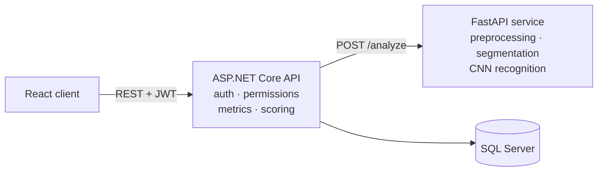

# Graphologital


A full-stack system that analyzes scanned Hebrew handwriting: it segments the page into characters, recognizes them with a CNN, extracts 59 graphological measurements, and scores the writer against nine personality types.

**Tech stack:** C# · ASP.NET Core 8 · Python · FastAPI · TensorFlow/Keras · OpenCV · React · Vite · Tailwind CSS · SQL Server

<!-- Demo: drag a short screen recording into the GitHub README editor here, or add a screenshot:
 -->

## What it does

The system has two user roles, and access between them is controlled by the candidate:

- **Candidate** uploads a scanned handwriting sample, receives a personality report, and chooses which recruiters may view it.
- **Recruiter** sees only the reports that candidates explicitly shared with them, together with the contact details those candidates provided.

In the code, the recruiter role is named `TargetUser`.

## Architecture



| Component | Responsibility |
|---|---|
| **React client** | Registration and login, handwriting upload, report display, permission management. |
| **ASP.NET Core API** | JWT authentication, input validation, permission checks, graphological measurements, personality scoring, persistence. |
| **FastAPI service** | Image preprocessing, segmentation into characters, letter recognition. Returns each character's position, size, recognized letter and confidence. |
| **SQL Server** | Users, access permissions and analysis results. |

The services communicate over HTTP only. The client never accesses the database, and the image-processing service has no knowledge of users or permissions.

## Analysis pipeline

1. **Preprocessing** (Python): binarization and noise cleanup of the scanned page.
2. **Segmentation** (Python): contour detection produces a bounding box per character. Broken characters are merged and connected ones are split, using the recognizer's confidence to decide. Boxes are then ordered into lines.
3. **Letter recognition** (Python): a CNN classifies each character into one of the 27 Hebrew letter forms, including final forms. The recognition confidence is later used as a readability measure.
4. **Graphological measurements** (C#): 59 measurements in the three classic areas of graphology:
    - *Organization:* margins, line, word and character spacing, line direction and its stability.
    - *Form:* slant, writing zones and their ratios, letter width, geometric shape, style, readability.
    - *Movement:* stroke thickness, pressure, stroke edges, flow, speed and movement characteristics.
5. **Scoring** (C#): each measurement is mapped to a level (for example small, average or large) using configurable thresholds, compared with the expected profile of each of the nine personality types, and weighted. The result is a match score per type and a leading type. In addition, 16 trait "syndromes" are evaluated, following the graphological principle that a conclusion requires a combination of signs, never a single one.

All thresholds, type profiles, weights and syndrome definitions live in JSON files, so the model of graphology can be tuned without changing code.

### Letter recognition model

| | |
|---|---|
| **Dataset** | HHD, the Handwritten Hebrew Dataset (27 classes) |
| **Input** | 64×64 grayscale, normalized to [0, 1] |
| **Architecture** | 3 × (Conv2D 3×3 + MaxPooling), with 32, 64 and 128 filters → Dense 256 → Dropout 0.4 → Softmax |
| **Training** | Adam optimizer, data augmentation (random rotation and zoom up to 10%), early stopping on validation performance |

<!-- If you have it, add a row here: | **Test accuracy** | XX% | -->

## Security

- Passwords are stored as salted hashes (ASP.NET Core `PasswordHasher`), never in plain text.
- Every protected endpoint requires a JWT. The signing key is kept out of the repository (User Secrets).
- Personal details and report text are encrypted at rest with ASP.NET Core Data Protection.
- All SQL queries are parameterized.
- Candidates control who can see their reports; recruiters see only what was shared with them.
- CORS is restricted to the client's origin.

## API

| Method | Endpoint | Description |
|---|---|---|
| POST | `/api/candidates/register` | Register a candidate |
| POST | `/api/candidates/login` | Candidate login, returns a JWT |
| GET | `/api/candidates/analyses` | The candidate's analysis history |
| POST | `/api/handwriting/upload` | Upload a handwriting image and run the analysis |
| GET | `/api/permissions/targets` | Recruiters and the candidate's sharing status with each |
| POST | `/api/permissions/{targetUserId}` | Share the candidate's reports with a recruiter |
| DELETE | `/api/permissions/{targetUserId}` | Revoke access |
| POST | `/api/targetusers/register` | Register a recruiter |
| POST | `/api/targetusers/login` | Recruiter login, returns a JWT |
| GET | `/api/targetusers/candidates` | Candidates who shared their reports with this recruiter |

Swagger UI is available while the API runs in the Development environment.

## Getting started

**Prerequisites:** .NET 8 SDK, Python 3.11, Node.js 18+, SQL Server (Express is enough).

The commands below are for PowerShell on Windows.

### 1. Database

Run the scripts in `database/` in order, in SQL Server Management Studio or with `sqlcmd`:

```powershell
sqlcmd -S localhost -E -C -i database/01_create_database_tables.sql
sqlcmd -S localhost -E -C -i database/02_create_login_permissions.sql
```

The API connects with Windows authentication to `localhost`. If you use a named instance, update the connection string in `api/appsettings.json`.

### 2. ML service

```powershell
cd ml-service
pip install -r requirements.txt
python communication_server.py
```

Listens on `http://127.0.0.1:8000`. The trained model (`handwriting_model.keras`) is included.

### 3. API

```powershell
cd api
dotnet user-secrets set "Jwt:Key" "<a random string of at least 32 characters>"
$env:ASPNETCORE_ENVIRONMENT = "Development"
dotnet run
```

Listens on `http://localhost:5000`.

> ImageSharp 3.2+ prints a license warning at build time. Debug builds work without a key. For Release builds, request a free community license at https://licensing.sixlabors.com and set it in the `SixLaborsLicenseKey` environment variable.

### 4. Client

```powershell
cd client
npm install
npm run dev
```

Open `http://localhost:5173` and register as a candidate or a recruiter.

### Retraining the model (optional)

Download the HHD dataset, then:

```powershell
cd ml-service
python train_model.py --train-dir "<path>\TRAIN" --test-dir "<path>\TEST"
```

## Input requirements and limitations

- Hebrew handwriting only.
- Best results with a blank A4 page, written with a ballpoint pen and scanned at good quality without scan margins.
- Supported formats: PNG, JPG, TIF/TIFF and PDF.

## Disclaimer

Graphology is scientifically contested. This is an engineering and research project, not a validated psychological assessment, and it should not be used as the sole basis for any decision about a person. Analyzing someone's handwriting requires their informed consent.

## Future work

- Automatic image quality check before analysis, with guidance to the user.
- Comparing several samples from the same writer, to track changes over time.
- Support for additional languages.
- Forensic handwriting comparison (similarity between samples, signature anomalies).

## Project structure

```
api/
  ApiLayer/        controllers and services: auth, permissions, encryption, database, analysis flow
  Extraction/      handwriting model and the 59 measurements (organization, form, movement)
  Inference/       level mapping, personality-type scoring and trait syndromes
  Configuration/   strongly typed settings
  *.json           thresholds, type profiles, weights, syndromes and report texts
ml-service/
  communication_server.py      FastAPI entry point
  Division_into_characters.py  preprocessing and segmentation
  model_used_afect.py          CNN inference
  train_model.py               training script
  experiments/                 research scripts, not used at runtime
client/            React + Vite client
database/          SQL Server setup scripts
docs/              PlantUML design diagrams
```

## Acknowledgments

- **HHD dataset:** I. Rabaev, B. Kurar Barakat, A. Churkin and J. El-Sana, *The HHD Dataset*, ICFHR 2020. Available on [Zenodo](https://zenodo.org/record/4287442).
- The character segmentation approach was based on [Text-Segmentation-From-Images](https://github.com/Lotemn102/Text-Segmentation-From-Images) by Lotemn102.

## License

MIT, see [LICENSE](LICENSE).
